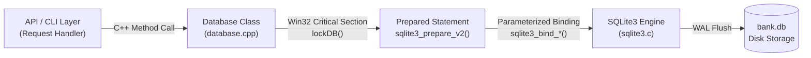
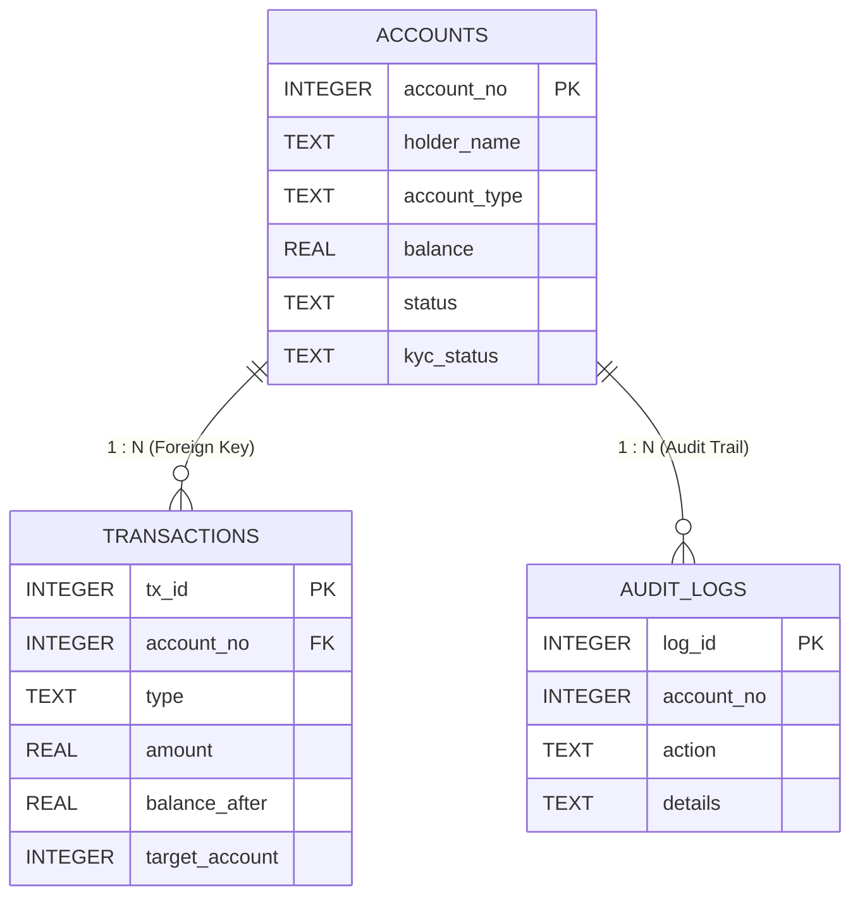

# APEX CORE BANKING SYSTEM
## SQL Database Engine & Data Architecture Report

---

**Focus Area:** Relational SQL Database Architecture, Schema Design, and Transactional Integrity  
**Database Engine:** Embedded SQLite 3.45 (`bank.db`)  
**Core Implementation:** [`database.h`](file:///c:/Users/Soft%20Game%20Studio/OneDrive/Document/CA%20Project/database.h), [`database.cpp`](file:///c:/Users/Soft%20Game%20Studio/OneDrive/Document/CA%20Project/database.cpp), [`models.h`](file:///c:/Users/Soft%20Game%20Studio/OneDrive/Document/CA%20Project/models.h)  
**Storage Model:** ACID Compliant with Write-Ahead Logging (`WAL`)  

---

# TABLE OF CONTENTS (INDEX)

- [1. Architecture Snapshot: The SQL Persistence Slice](#1-architecture-snapshot-the-sql-persistence-slice)
- [2. Database Engine Overview (Embedded SQLite3)](#2-database-engine-overview-embedded-sqlite3)
- [3. Engine Initialization & Performance PRAGMAs](#3-engine-initialization--performance-pragmas)
- [4. Relational Schema & Table Definitions (DDL)](#4-relational-schema--table-definitions-ddl)
  - [4.1 `accounts` Table](#41-accounts-table)
  - [4.2 `transactions` Table](#42-transactions-table)
  - [4.3 `audit_logs` Table](#43-audit_logs-table)
- [5. Entity-Relationship (ER) Structure & Constraints](#5-entity-relationship-er-structure--constraints)
- [6. ACID Transactions: Commit and Rollback Mechanisms](#6-acid-transactions-commit-and-rollback-mechanisms)
- [7. Core Banking SQL Operations in Action (DML)](#7-core-banking-sql-operations-in-action-dml)
  - [7.1 Account Opening Insert](#71-account-opening-insert)
  - [7.2 Cash Deposit Query](#72-cash-deposit-query)
  - [7.3 Cash Withdrawal Query](#73-cash-withdrawal-query)
  - [7.4 Atomic Fund Transfer Transaction](#74-atomic-fund-transfer-transaction)
  - [7.5 KYC and Status Updates](#75-kyc-and-status-updates)
  - [7.6 Reporting & Analytical Queries](#76-reporting--analytical-queries)
- [8. Security: Parameterized Binding & SQL Injection Prevention](#8-security-parameterized-binding--sql-injection-prevention)
- [9. Physical Storage Layout (`bank.db`, `-wal`, `-shm`)](#9-physical-storage-layout-bankdb--wal--shm)

---

# 1. ARCHITECTURE SNAPSHOT: THE SQL PERSISTENCE SLICE

To understand where SQL operates, here is the minimal architectural slice connecting application requests to the database engine:



* **Role:** The C++ backend never executes arbitrary concatenated strings. The [`Database`](file:///c:/Users/Soft%20Game%20Studio/OneDrive/Document/CA%20Project/database.h#L10-L46) class acts as an internal Data Access Object (DAO) that mediates between high-level business models ([`models.h`](file:///c:/Users/Soft%20Game%20Studio/OneDrive/Document/CA%20Project/models.h)) and raw SQLite C-APIs.
* **Synchronization:** A Win32 `CRITICAL_SECTION` serializes all SQL access so multiple concurrent HTTP worker threads never corrupt database handles.

---

# 2. DATABASE ENGINE OVERVIEW (EMBEDDED SQLITE3)

Instead of relying on external standalone database server processes (such as PostgreSQL or MySQL) that require network sockets and separate service management, this project embeds **SQLite 3.45**:
- **In-Process Engine:** Executes inside the memory space of `bank_server.exe`.
- **Zero Configuration:** Automatically creates `bank.db` on startup if absent.
- **Cross-Platform Storage:** Single self-contained binary file containing table definitions, indices, and data rows.

---

# 3. ENGINE INITIALIZATION & PERFORMANCE PRAGMAS

Upon database startup ([`Database::init()`](file:///c:/Users/Soft%20Game%20Studio/OneDrive/Document/CA%20Project/database.cpp#L37-L50)), two crucial SQL PRAGMA statements are issued before any table creation:

```sql
-- 1. Enforce strict referential integrity
PRAGMA foreign_keys = ON;

-- 2. Activate Write-Ahead Logging for high-concurrency performance
PRAGMA journal_mode = WAL;
```

### Why These PRAGMAs Matter:
1. `PRAGMA foreign_keys = ON;`: By default, SQLite disables foreign key validation for backward compatibility. Enabling it ensures no transaction row can be inserted with an invalid `account_no`.
2. `PRAGMA journal_mode = WAL;`: Write-Ahead Logging allows readers to read from `bank.db` simultaneously while writes are being committed to `bank.db-wal`, eliminating read-lock contention.

---

# 4. RELATIONAL SCHEMA & TABLE DEFINITIONS (DDL)

The database schema is comprised of three normalized relational tables defined in [`database.cpp`](file:///c:/Users/Soft%20Game%20Studio/OneDrive/Document/CA%20Project/database.cpp#L51-L95):

### 4.1 `accounts` Table
Maintains customer profile records, financial balances, and account states.

```sql
CREATE TABLE IF NOT EXISTS accounts (
    account_no   INTEGER PRIMARY KEY AUTOINCREMENT,
    holder_name  TEXT NOT NULL,
    account_type TEXT NOT NULL DEFAULT 'Savings',
    email        TEXT,
    phone        TEXT,
    balance      REAL NOT NULL DEFAULT 0.0,
    status       TEXT NOT NULL DEFAULT 'ACTIVE',     -- ACTIVE, FROZEN, CLOSED
    kyc_status   TEXT NOT NULL DEFAULT 'VERIFIED',   -- PENDING, VERIFIED, REJECTED
    id_type      TEXT,                               -- Passport, National ID, Driver License
    id_number    TEXT,
    address      TEXT,
    created_at   DATETIME DEFAULT CURRENT_TIMESTAMP,
    updated_at   DATETIME DEFAULT CURRENT_TIMESTAMP
);
```

### 4.2 `transactions` Table
An immutable financial ledger recording every balance modification event.

```sql
CREATE TABLE IF NOT EXISTS transactions (
    tx_id          INTEGER PRIMARY KEY AUTOINCREMENT,
    account_no     INTEGER NOT NULL,
    type           TEXT NOT NULL,                      -- DEPOSIT, WITHDRAWAL, TRANSFER_IN, TRANSFER_OUT
    amount         REAL NOT NULL,
    balance_after  REAL NOT NULL,
    target_account INTEGER DEFAULT 0,
    remarks        TEXT,
    timestamp      DATETIME DEFAULT CURRENT_TIMESTAMP,
    FOREIGN KEY (account_no) REFERENCES accounts(account_no)
);
```

### 4.3 `audit_logs` Table
A tamper-resistant security log recording all administrative and financial actions.

```sql
CREATE TABLE IF NOT EXISTS audit_logs (
    log_id      INTEGER PRIMARY KEY AUTOINCREMENT,
    account_no  INTEGER NOT NULL,
    action      TEXT NOT NULL,                         -- CREATE, DEPOSIT, WITHDRAW, TRANSFER, FREEZE, UNFREEZE, KYC_UPDATE, DELETE
    details     TEXT,
    timestamp   DATETIME DEFAULT CURRENT_TIMESTAMP
);
```

---

# 5. ENTITY-RELATIONSHIP (ER) STRUCTURE & CONSTRAINTS



### Key Relational Constraints:
* **Primary Keys (`PK`):** `account_no`, `tx_id`, and `log_id` use `AUTOINCREMENT` to ensure uniqueness.
* **Foreign Key (`FK`):** `transactions.account_no` references `accounts.account_no`. Any attempt to insert a ledger entry for a non-existent account number is aborted by SQLite.
* **Check Logic in C++ Layer:** Withdrawals verify ₹balance \ge amount₹; closures enforce ₹balance == 0.00₹.

---

# 6. ACID TRANSACTIONS: COMMIT AND ROLLBACK MECHANISMS

Financial transfers require multi-query Atomicity. If power fails or an error occurs halfway through, no money can disappear or duplicate.

The C++ database engine enforces explicit SQL transaction boundaries:

```cpp
executeSimple("BEGIN TRANSACTION;");

// Step 1: Debit sender
// Step 2: Record sender TRANSFER_OUT
// Step 3: Credit recipient
// Step 4: Record recipient TRANSFER_IN
// Step 5: Record audit log

if (any_step_failed) {
    executeSimple("ROLLBACK;");  // Restores original balances immediately
    return false;
}

executeSimple("COMMIT;");        // Persists all changes atomically
```

---

# 7. CORE BANKING SQL OPERATIONS IN ACTION (DML)

### 7.1 Account Opening Insert
Creates customer entity and seeds ledger record:
```sql
-- 1. Insert customer record
INSERT INTO accounts (holder_name, account_type, email, phone, balance, status, kyc_status, id_type, id_number, address)
VALUES (?, ?, ?, ?, ?, ?, ?, ?, ?, ?);

-- 2. Insert starting ledger entry (if initial_deposit > 0)
INSERT INTO transactions (account_no, type, amount, balance_after, target_account, remarks)
VALUES (?, 'DEPOSIT', ?, ?, 0, 'Account Opening Initial Deposit');

-- 3. Log event
INSERT INTO audit_logs (account_no, action, details)
VALUES (?, 'CREATE', 'Account opened with Savings plan.');
```

### 7.2 Cash Deposit Query
Increments customer balance and writes to ledger:
```sql
UPDATE accounts 
SET balance = balance + ?, updated_at = CURRENT_TIMESTAMP 
WHERE account_no = ?;

INSERT INTO transactions (account_no, type, amount, balance_after, target_account, remarks)
VALUES (?, 'DEPOSIT', ?, ?, 0, ?);
```

### 7.3 Cash Withdrawal Query
Debits balance with balance-safeguard validation:
```sql
UPDATE accounts 
SET balance = balance - ?, updated_at = CURRENT_TIMESTAMP 
WHERE account_no = ?;

INSERT INTO transactions (account_no, type, amount, balance_after, target_account, remarks)
VALUES (?, 'WITHDRAWAL', ?, ?, 0, ?);
```

### 7.4 Atomic Fund Transfer Transaction
Executes an intra-bank transfer between Account `#A` and `#B` in one atomic unit:
```sql
BEGIN TRANSACTION;

-- Leg 1: Debit Sender
UPDATE accounts SET balance = balance - 250.00, updated_at = CURRENT_TIMESTAMP WHERE account_no = 10010001;
INSERT INTO transactions (account_no, type, amount, balance_after, target_account, remarks)
VALUES (10010001, 'TRANSFER_OUT', 250.00, 24250.00, 10010002, 'Transfer to #10010002');

-- Leg 2: Credit Recipient
UPDATE accounts SET balance = balance + 250.00, updated_at = CURRENT_TIMESTAMP WHERE account_no = 10010002;
INSERT INTO transactions (account_no, type, amount, balance_after, target_account, remarks)
VALUES (10010002, 'TRANSFER_IN', 250.00, 82400.00, 10010001, 'Transfer from #10010001');

-- Audit Log Entry
INSERT INTO audit_logs (account_no, action, details)
VALUES (10010001, 'TRANSFER', 'Transferred ₹250.00 from #10010001 to #10010002');

COMMIT;
```

### 7.5 KYC and Status Updates
Modifies operational flags without touching monetary balances:
```sql
-- Update KYC documents and status
UPDATE accounts 
SET kyc_status = ?, id_type = ?, id_number = ?, address = ?, updated_at = CURRENT_TIMESTAMP 
WHERE account_no = ?;

-- Freeze or Unfreeze account
UPDATE accounts 
SET status = ?, updated_at = CURRENT_TIMESTAMP 
WHERE account_no = ?;
```

### 7.6 Reporting & Analytical Queries
Used by the dashboard to compute real-time bank statistics:
```sql
-- Calculate bank reserve metrics in a single query
SELECT 
    COUNT(*) AS total_accounts,
    SUM(CASE WHEN status = 'ACTIVE' THEN 1 ELSE 0 END) AS active_accounts,
    SUM(CASE WHEN status = 'FROZEN' THEN 1 ELSE 0 END) AS frozen_accounts,
    SUM(CASE WHEN status = 'CLOSED' THEN 1 ELSE 0 END) AS closed_accounts,
    COALESCE(SUM(balance), 0.0) AS total_reserve,
    SUM(CASE WHEN kyc_status = 'VERIFIED' THEN 1 ELSE 0 END) AS kyc_verified,
    SUM(CASE WHEN kyc_status = 'PENDING' THEN 1 ELSE 0 END) AS kyc_pending
FROM accounts;
```

---

# 8. SECURITY: PARAMETERIZED BINDING & SQL INJECTION PREVENTION

Direct string concatenation (`"SELECT * FROM accounts WHERE name = '" + name + "'"` ) is strictly prohibited in the codebase.

Instead, the project uses SQLite prepared statement APIs:
1. `sqlite3_prepare_v2()`: Pre-compiles the SQL query template.
2. `sqlite3_bind_text()`: Binds strings safely as raw data, escaping quotes and control characters.
3. `sqlite3_bind_double()` / `sqlite3_bind_int()`: Binds numeric parameters with type enforcement.
4. `sqlite3_step()`: Executes the compiled query.
5. `sqlite3_finalize()`: Frees allocated statement memory.

### Code Sample from [`database.cpp`](file:///c:/Users/Soft%20Game%20Studio/OneDrive/Document/CA%20Project/database.cpp#L175-L210):
```cpp
const char* sql = "INSERT INTO accounts (holder_name, balance, status) VALUES (?, ?, ?);";
sqlite3_stmt* stmt = nullptr;

if (sqlite3_prepare_v2(db, sql, -1, &stmt, nullptr) == SQLITE_OK) {
    sqlite3_bind_text(stmt, 1, acc.holder_name.c_str(), -1, SQLITE_TRANSIENT);
    sqlite3_bind_double(stmt, 2, acc.balance);
    sqlite3_bind_text(stmt, 3, acc.status.c_str(), -1, SQLITE_TRANSIENT);
    sqlite3_step(stmt);
    sqlite3_finalize(stmt);
}
```

---

# 9. PHYSICAL STORAGE LAYOUT (`bank.db`, `-wal`, `-shm`)

When running on disk, SQLite generates three synchronized files:
1. **`bank.db`** (Main Database): Stores the schema tables, B-Trees, and page records.
2. **`bank.db-wal`** (Write-Ahead Log): Holds recently written transactions before they are checkpointed into `bank.db`.
3. **`bank.db-shm`** (Shared Memory Index): Used by concurrent threads to track valid pages in the WAL file without disk bottlenecks.

